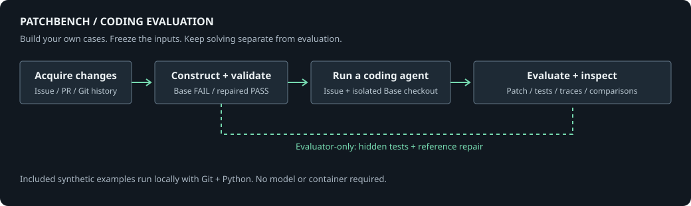
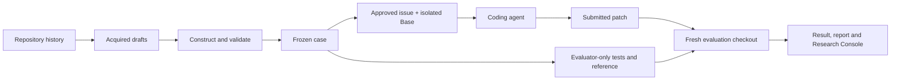

# PatchBench

**Build benchmark cases from repository history, evaluate coding agents on them,
and inspect the results.**

PatchBench is a research harness for studying whether coding agents can repair
software defects. Inspired by SWE-bench, it pairs an issue with a frozen bug
revision and evaluates the submitted patch using executable tests. It also helps
researchers construct those cases, record how they were accepted, and inspect
what happened during solving.

The framework was developed in a CERN master's thesis. The research case corpus
is private and is not distributed. You can run the complete evaluation loop on
three original synthetic examples immediately, then construct your own benchmark
from repositories you can access. The examples demonstrate the method; their
controls are **not measurements of model performance**.



## Quick Start

Requirements: Python **3.9+**, Git, and [uv](https://docs.astral.sh/uv/).
The examples use only the Python standard library after installing PatchBench.
No CERN access, container runtime, API token or LLM is needed.

Run these commands in Bash:

```bash
git clone https://github.com/Namprire/patchbench.git
cd patchbench
uv sync --frozen --extra dev
. .venv/bin/activate

# Choose a destination that does not already exist.
export PATCHBENCH_EXAMPLES="$PWD/../patchbench-examples"
python -m patchbench.demo "$PATCHBENCH_EXAMPLES"
export CASE_DIR="$PATCHBENCH_EXAMPLES/cases/demo-label"

patchbench validate-case "$CASE_DIR"
patchbench run "$CASE_DIR" --agent gold --run-id gold-r1 --no-live
patchbench report "$PATCHBENCH_EXAMPLES/artifacts/demo-label/runs/gold-r1"
cat "$PATCHBENCH_EXAMPLES/artifacts/demo-label/runs/gold-r1/report.md"
```

Validation must succeed and the gold control must resolve the task. Now run the
negative control:

```bash
patchbench run "$CASE_DIR" --agent dummy --run-id dummy-r1 --no-live
```

**Expected exit status: 1**, with `no_code_change`. Dummy deliberately submits
nothing. This checks the unresolved path; validation separately runs the tests on
the bug revision and establishes a behavioral failure before the gold repair.

Run IDs are immutable: choose a new ID for each attempt. To regenerate the inputs,
choose a new example destination. Nothing in this walkthrough modifies the
PatchBench source checkout.

Optional next steps: [open the console](#research-console),
[run a real agent](#run-a-real-coding-agent), or
[construct cases from Rucio](#construct-your-own-cases-from-rucio).

## What is implemented

- Acquisition of merged changes, draft construction, validation and case promotion.
- Historical reconstruction using the developer's tests, and reconstruction of a
  defect against a verified reference revision using existing tests.
- Optional bounded model assistance for triage, construction and hidden regression
  generation, followed by executable acceptance checks.
- Host or rootless Podman evaluation, Claude Code and container-command adapters.
- Frozen inputs, immutable attempts, patch capture, execution traces and reports.
- A React Research Console for runs, artifacts, comparisons and construction.

The public profile provides the generic coding workflow and public Rucio
configuration. Service integrations requiring private infrastructure are not
included. Users supply their own source repositories, cases and provider access.

## Runnable synthetic benchmark cases

All three cases are generated by [patchbench.demo](src/patchbench/demo.py).
Source code, issues, reference repairs and evaluator tests were written specifically
for these examples, independently of the research corpus.

| Case | Difficulty | Defect and evaluation |
| --- | --- | --- |
| `demo-label` | Easy | Join words with the correct separator; preserve empty and single-word inputs. |
| `demo-config` | Medium | Parse typed configuration, reject invalid/duplicate settings, and preserve valid defaults. |
| `demo-ranges` | Harder | Handle nested half-open intervals and total coverage consistently across two modules; either single-file repair is insufficient. |

Generate just one case with `python -m patchbench.demo /tmp/new-demo --case demo-config`.
The default invocation generates all three under one corpus:

```text
patchbench-examples/
  sources/<case-id>/       # Original local Git repository, including frozen Base/Fix
  cases/<case-id>/
    meta.yaml             # Frozen commits, test command and artifact roles
    issue.md              # Solver-visible problem statement
    provenance.json       # Explicit synthetic origin and difficulty
    gold.patch            # Evaluator-only reference repair
    test.patch            # Evaluator-only regression tests
  artifacts/<case-id>/     # Created by validation and agent runs
```

Source commits use a fixed synthetic identity and date to make regenerated inputs
repeatable; that date is not the project's copyright year. Cases run with Python
and `unittest`, without external packages or network calls.

Validate every case and run both batch controls:

```bash
for case in "$PATCHBENCH_EXAMPLES"/cases/*; do
  patchbench validate-case "$case"
done
patchbench run-all --cases-dir "$PATCHBENCH_EXAMPLES/cases" \
  --case-type coding --agent gold --run-id gold-suite-r1
# Expected exit status 1: all three dummy attempts remain unresolved.
patchbench run-all --cases-dir "$PATCHBENCH_EXAMPLES/cases" \
  --case-type coding --agent dummy --run-id dummy-suite-r1
patchbench report "$PATCHBENCH_EXAMPLES/artifacts"
```

The three gold attempts must pass; the three dummy attempts must fail. Reports on
this corpus describe controls only. Tests additionally verify that the broken
source fails assertions, the reference patch passes, and solver checkouts contain
neither evaluator tests nor reference-fix Git objects.

To evaluate an independently saved patch on the host:

```bash
patchbench evaluate-patch "$CASE_DIR" --patch /absolute/path/to/candidate.patch
```

## Core architecture



| Component | Responsibility | Implementation |
| --- | --- | --- |
| CLI and case metadata | Explicit commands, frozen inputs, path validation | [cli.py](src/patchbench/cli.py), [case.py](src/patchbench/case.py) |
| Acquisition and construction | Turn source changes into reviewable executable drafts | [github_ingest.py](src/patchbench/github_ingest.py), [historical_pr_tests.py](src/patchbench/historical_pr_tests.py), [mirroring](src/patchbench/mirroring) |
| Evaluation | Isolate solving from tests; apply patches and run declared checks | [commands.py](src/patchbench/commands.py), [gitutils.py](src/patchbench/gitutils.py) |
| Agent adapters | Execute a harness and retain its patch and evidence | [agents](src/patchbench/agents) |
| Evidence and reporting | Functional results, summaries, trace and dashboard export | [report.py](src/patchbench/report.py), [dashboard_export.py](src/patchbench/dashboard_export.py) |
| Research Console | Inspect runs and construct commands; optional local execution | [frontend](frontend), [server.py](src/patchbench/server.py) |
| Repository profiles | Source acquisition and compatible evaluator/solver images | [repositories/rucio.yaml](repositories/rucio.yaml), [images](images) |

There is no LLM judge for coding-agent success. Tests determine functional success;
patch similarity, token usage, cost and runtime are supporting observations.

## Installation and execution environments

Use a source checkout so repository manifests and image recipes stay available.
`uv sync --frozen --extra dev` installs the locked Python environment. An editable
pip installation (`python -m pip install -e '.[dev]'`) also works, but does not
reproduce that lockfile.

| Workflow | Required environment |
| --- | --- |
| Synthetic cases and gold/dummy controls | Python 3.9+, Git; host execution |
| Claude Code on a synthetic case | Host Claude Code CLI and configured model provider |
| Research Console | Node **22.13+ on the 22.x line, or 24+**, and npm |
| Rucio construction / offline evaluation | Rootless Podman, source history, compatible evaluator/solver images |
| Custom container agent | Rootless Podman, an image and a command that edits the checkout |

`uv.lock` and [frontend/package-lock.json](frontend/package-lock.json) are the
public dependency baselines. Container recipes pin relevant tool versions, but
a tag alone is not a reproducible image identity; record actual image digests.
Historical repositories can need different Python versions and dependency caches.

## Run a real coding agent

| Adapter | Behavior |
| --- | --- |
| `gold` | Supplies the reference repair; evaluator sanity control, not a model. |
| `dummy` | Supplies no patch; negative control, not a model. |
| `claude-code` | Invokes the Claude Code harness on the host or in a compatible solver container. |
| `container-command` | Runs a user-supplied solver command in a container and captures its source changes. |

Install the [Claude Code CLI](https://code.claude.com/docs/en/setup) separately.
The adapter name identifies the harness, not necessarily the model: compatible
provider gateways may route it to a different model. Use a model identifier your
provider actually accepts; PatchBench does not bundle model weights or provider
access, and does not claim every model works with this adapter.

Prepare a literal export file **outside the repository**, readable only by you:

```bash
export PROVIDER_ENV="$HOME/.config/patchbench/provider-env.sh"
# Create this file with your provider's authentication and endpoint settings.
# Example settings (replace placeholders; do not commit the file):
# export ANTHROPIC_AUTH_TOKEN='YOUR_TOKEN'
# export ANTHROPIC_BASE_URL='https://provider.example'
chmod 600 "$PROVIDER_ENV"
```

The file accepts literal export assignments, not command substitution or arbitrary
shell statements. Authentication settings depend on your provider; do not use a
placeholder endpoint for an actual run. Keep TLS verification enabled.

With the CLI and provider configured, run the same synthetic task:

```bash
patchbench run "$CASE_DIR" --agent claude-code \
  --agent-model YOUR_PROVIDER_MODEL_ID --agent-env-file "$PROVIDER_ENV" \
  --agent-max-turns 20 --agent-timeout-seconds 300 \
  --prompt-mode issue_only --run-id model-r1 --no-live
patchbench report "$PATCHBENCH_EXAMPLES/artifacts/demo-label/runs/model-r1"
```

This is a real model attempt and can incur provider costs; the quick-start controls
do not. No model call is needed to validate or inspect these examples.

`issue_only` supplies the approved issue. `issue_with_hints` also includes explicitly
declared relevant file paths. The solver starts in a fresh depth-one Base checkout,
without hidden tests, reference patches, Fix objects or a source remote. Tests are
injected only during evaluation in a separate checkout. The gold control is the
explicit exception that selects the evaluator's reference repair.

Host execution trusts the machine and adapter; a checkout is not an operating-system
sandbox. For stronger filesystem separation, use configured rootless Podman
execution. Strict historical/mirror modes require it. Offline evaluators and
network-enabled model solvers are separate environments.

## Construct your own cases from Rucio

Once the local examples work, use public repository history to build a research
corpus. The supplied GitHub intake supports [rucio/rucio](https://github.com/rucio/rucio).
It acquires candidates, not a preapproved benchmark. Construction may require
network access, sizeable image builds and historical dependency preparation.

### 1. Configure the source and runtimes

```bash
export PATCHBENCH_RUCIO_REPO="$HOME/patchbench-sources/rucio"
patchbench build-env rucio
podman build -f images/rucio-historical-tests.Containerfile \
  -t localhost/patchbench-rucio-historical:tests-v2 .
podman build -f images/rucio-claude-code.Containerfile \
  -t localhost/patchbench-rucio-claude:tests-v2 .
```

`pull-cases` clones the configured public source when necessary, or fetches an
existing checkout. Retain full historical Git objects. GitHub authentication uses
`GITHUB_TOKEN` or `GH_TOKEN` from your external environment when supplied; it may
be needed for API limits. Do not place source-provider tokens in case files.

### 2. Acquire candidate changes

```bash
patchbench pull-cases rucio --limit 10 --dry-run
patchbench pull-cases rucio --limit 10
```

Inspect `drafts/rucio/` and the candidate/construction evidence under
`artifacts/imports/rucio/`. Ordinary acquisition does not call a construction model
or promote drafts. To select a known merged PR, add `--candidate PR_NUMBER --limit 1`.

### 3. Construct and validate

Choose an acquired draft and review its suggested test scope. Replace the example
ID below with its actual directory name:

```bash
export DRAFT_ID=rucio-PR_NUMBER
patchbench prepare-historical-pr-tests "drafts/rucio/$DRAFT_ID"
patchbench validate-case "drafts/rucio/$DRAFT_ID" --container
```

Historical reconstruction separates the developer's production repair from their
exact tests. An optional `--test-node` limits execution to a reviewed test scope;
select that scope before inspecting failures. Validation requires a passing fixed
reference, behavioral failure before repair, success after repair and stable test
inventories. Compilation, dependency and test-collection errors are not behavioral
fail-to-pass evidence. A rejected draft stays outside the benchmark.

For cases better suited to a current reference, `prepare-environment` establishes
a green component and `mirror-draft` reconstructs the defect against it. Deterministic
reversal runs first. Optional role profiles enable model-assisted construction or
hidden regressions; those roles see different inputs from the evaluated solver.
Use `patchbench COMMAND --help` for the construction command's explicit options.

### 4. Review, freeze and benchmark

Review the solver-safe issue, provenance and validation evidence before promotion:

```bash
patchbench promote-draft rucio "$DRAFT_ID" --container
export CASE_DIR="$PWD/cases/$DRAFT_ID"
patchbench run "$CASE_DIR" --agent gold --run-id gold-check-r1 --container --no-live
patchbench run "$CASE_DIR" --agent claude-code \
  --agent-model YOUR_PROVIDER_MODEL_ID --agent-env-file "$PROVIDER_ENV" \
  --agent-max-turns 100 --agent-timeout-seconds 900 \
  --run-id model-r1 --container --no-live
```

Use the case's compatible evaluator/solver images. The acquired source and all
Base/Fix/reference commits remain part of your reproducibility inputs.

For a collection, `run-all --cases-dir cases --case-type coding --agent claude-code`
accepts the same provider, turn/time-budget and container options. Batches run
sequentially, preserve per-case outcomes and write their selection and summary
under `artifacts/batches/<run-id>/`.

### Larger collections and other repositories

After preparing runtimes, harvesting can schedule construction under explicit
budgets without paid model fallbacks:

```bash
patchbench pull-cases rucio --harvest --session my-rucio-build \
  --time-budget-seconds 3600 --model-budget-usd 0
# Resume that session without fetching a different candidate set:
patchbench pull-cases rucio --harvest --session my-rucio-build --resume \
  --time-budget-seconds 3600 --model-budget-usd 0 --no-sync
```

Inspect rejected attempts as well as accepted drafts; construction yield and model
success are different quantities. Paid fallbacks need explicit role profiles and
budgets. Review and promote accepted cases before evaluating a model.

Additional source repositories need manifests, compatible runtime recipes and
construction support. Generic local coding cases can declare their own checkout
and test command. Arbitrary GitHub URLs are not supported by the current Rucio
intake; they need an implementation extension rather than a changed URL alone.

## Evaluation and case formats

```text
frozen Base + evaluator tests                  -> behavioral FAIL
frozen Base + evaluator tests + reference fix  -> PASS
frozen Base + evaluator tests + agent patch    -> scored outcome
```

An injected-test case declares `id`, `case_type: coding`, `repo_path`,
`base_commit`, `fix_commit`, `test_command`, `problem_statement`, `gold_patch`
and `test_patch` in `meta.yaml`. Repository-backed cases can use
`repository: rucio` instead of a literal checkout path. Optional settings include
`image`, `workdir`, `env`, `setup_commands`, `timeout_seconds` and
`hints.relevant_files`. Artifact paths stay inside the case and source paths inside
the checkout. Commands are parsed without a shell; patches must apply exactly.

| Construction path | Oracle and acceptance |
| --- | --- |
| Injected regression (the demos) | Evaluator-only test patch; Base fails and the reference repair passes. |
| Historical developer tests | Exact historical tests and production repair, clean Reference and repeated behavioral F2P/Gold checks. |
| Mirrored defect | Verified reference, reconstructed bug and repaired version, with stable existing regressions and optional hidden coverage. |

F2P means fail-to-pass; P2P means a regression remains passing. The small demos
exercise the basic injected-test pipeline, not every stricter historical or mirror
acceptance rule. New tests may establish validity without making a task realistic.

## Evidence, reports and comparisons

For a corpus laid out like the examples, evidence is stored beside `cases/`:

```text
artifacts/<case-id>/
  validation.json
  logs/
  runs/<run-id>/
    result.json          # Functional verdict, failure/termination observations
    metadata.json        # Provider/model, budgets and invocation
    prompt.txt           # Exact solver-visible prompt
    agent.patch          # Captured source diff, including partial submissions
    test.log             # Evaluator output or skip explanation
    trajectory.log       # Human-readable model/tool trace, when available
    agent_events.jsonl   # Structured agent events, when available
    report.md            # Generated by patchbench report
```

`patchbench report PATH` recursively reads result records and writes `report.md`
and `summary.json`. Scope PATH to the attempt or experiment you mean to report.
The console links the patch, logs and execution stages and compares two to four
runs. Missing token/cost observations remain unknown.

Freeze case selection, prompt mode, runtime, provider/model and budgets before
comparing conditions. Keep attempt IDs and a declared retry-selection rule. Exclude
gold/dummy controls and construction attempts from model success rates. A captured
partial patch may still be evaluated after a model budget is exhausted; the
termination reason is retained separately from the test outcome.

To reproduce a fixed-patch evaluation, retain case files, Base/Fix/reference Git
objects, image digests, lockfiles/dependency caches, commands, selection, harness
revision and original evidence. A shallow upstream source clone may lack required
commits. A new model attempt can differ even with identical frozen tests. The
private CERN research scores cannot be reconstructed from this synthetic release.

## Research Console

The React console is a read-only viewer by default. Its public sample contains
**three synthetic cases and six gold/dummy control records**, with fixed illustrative
timestamps and timings. It contains no private dashboard snapshot or model scores.

| Workspace | What you can inspect |
| --- | --- |
| Overview | Scope, outcomes and available runtime/token/cost observations |
| Runs | Search, filters, sorting and a comparison tray |
| Run detail | Prompt, submitted patch, test log, execution stages and available traces |
| Compare | Two-to-four-run comparisons on consistent inputs |
| Cases | Issue, safe metadata, validation state and linked attempts |
| Build | Acquisition/construction flow, generated CLI commands and labeled UI simulation |

From the project root:

```bash
cd frontend
npm ci
npm run dev
```

Open **http://localhost:5180**. `predev` exports the bundled synthetic records; it
does not run tests or call a model. To inspect the cases and results you generated,
stop the server and restart from the same frontend directory:

```bash
PATCHBENCH_CASES_DIR="$PATCHBENCH_EXAMPLES/cases" npm run dev
```

For a different corpus, set that variable to its absolute `cases/` directory.
Current artifacts beside the corpus are discovered automatically.
`PATCHBENCH_RUNS_DIR` optionally selects legacy run records. Do not mix unrelated
corpora when calculating experiment metrics.

The Build workspace's simulation demonstrates the interface. For actual local
execution on the examples, use a terminal with the PatchBench environment
activated and `PATCHBENCH_EXAMPLES` set to the same path as in Quick Start.
Start the service from the corpus directory containing `cases/`:

```bash
(cd "$PATCHBENCH_EXAMPLES" && patchbench serve --dev)
```

For a Rucio corpus constructed inside the PatchBench project, start the service
from that project root instead. Its working directory selects the corpus.

The execution service defaults to **127.0.0.1:8765**, validates loopback browser
origins and serializes work. It is opt-in; `npm run dev` does not start it. Keep
this unauthenticated researcher service local. A hosted static viewer must not
expose the execution service.

Build a static viewer from the frontend directory:

```bash
npm run export-data
npm run build
```

The output is `frontend/dist/`, including `LICENSE.txt` and
[THIRD_PARTY_NOTICES.txt](THIRD_PARTY_NOTICES.txt). Retain both when redistributing
the viewer, including its bundled fonts and icons. Exported views
omit evaluator test patches and reference fixes by default; do not use researcher-only
`--include-gold` for a solver or public viewer. Prompts, submitted patches and traces
can still contain your source material: review your own data before publishing it.

## Limitations and contributions

This is a research tool, not a claim that the example tasks measure real-world
coding ability. Passing tests are evidence for the declared behavior, not proof
of complete correctness. Historical dependencies, construction eligibility and
supported repository components constrain the tasks you can construct.

Contributions to generic evaluation, adapters, construction and the console are
welcome. Include a small synthetic regression and relevant checks; do not submit
private cases, source, tokens or raw research traces. Public contributions are
reviewed downstream, then manually integrated into the private upstream source of
truth and included in a new sanitized export. The repositories are not mirrored.

From the project root, run the portable backend suite:

```bash
python -m pytest -q
```

Frontend checks:

```bash
cd frontend
npm run lint
npm run typecheck
npm run test
npm run export-data
npm run build
```

## License

Copyright (C) CERN 2026. PatchBench uses the **Apache License, Version 2.0**, with
the CERN privileges-and-immunities statement, following the
[CERN licensing reference](https://github.com/marian-babik/python-nap/blob/master/LICENSE).
The license's original publication date remains **January 2004**; it is distinct
from the project's copyright year.

See [LICENSE.txt](LICENSE.txt), [third-party notices](THIRD_PARTY_NOTICES.txt), and
[publication status](PUBLICATION.md). Dependency and externally acquired source
licenses remain their own; PatchBench's license does not relicense your cases or
the repositories they refer to.
